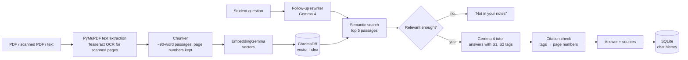

# NoteWise AI

**Your Notes. Your Learning Companion.**

An offline study companion that turns a student's own notes into a tutor. It answers from the uploaded notes with page references, quizzes the student and explains their mistakes, and says clearly when the notes don't contain the answer.

Team **Neural Nomads** · IIMT University, Meerut · Hacktoberfest Hackday 2026 (Hackday@Meerut × E-Cell IIMTU)
Track 1: **Best Use of Gemma 4** · Problem Statement **PS 01: Study Companion from Real Notes**

---

## The problem

Students revise from lecture notes, PDFs and scanned pages. General AI chatbots answer from their own general knowledge, not from the student's syllabus, and they rarely admit when the student's notes don't cover something. NoteWise keeps the AI grounded in what the student actually studied.

## Features

| Feature | What it does |
|---|---|
| **Upload notes** | PDF (text or scanned), `.txt`/`.md`, or pasted text. Every page is read and its page number is kept. Scanned pages go through OCR. |
| **Ask questions** | Gemma 4 answers in simple language using only the retrieved passages. Each sentence links to a page (`p. 4`), and the passages can be opened and checked. |
| **Whole-document questions** | "Explain this PDF", "summarize my notes" or "name the topics" get an overview built from passages on every page (and every file in the chat), still with page citations. |
| **Honest refusals** | Off-topic or unsupported questions get *"I couldn't find enough information in your uploaded notes…"* instead of a made-up answer. |
| **Follow-up questions** | "Explain that in simpler words" or "Which gas is released in it?" are understood from the conversation, and fresh evidence is retrieved every time. |
| **Saved chats** | Conversations, their notes and their citations are stored in SQLite. Reopen, rename or delete chats; they survive refreshes and restarts. |
| **Quiz & feedback** | 5 multiple-choice questions from different pages. A wrong answer shows the correct one, why the student's choice is wrong, an explanation, a hint and the source passage. |
| **Mood-Aware Study Mode** | Pick how you feel (fresh, tired, stressed, finding it difficult…), a goal and a session length. NoteWise builds a guided session from your notes: a grounded explanation in a tone and depth that suits your mood, practice questions at a matching difficulty, then a summary with what to revise next. |
| **My Learning DNA** | A personal profile counted from real activity: notes, questions attempted, accuracy, study streak, topic mastery, how you ask for help, and your next best step. |
| **Mistake Memory** | Remembers every page you got wrong: your answer, the correct one, the passage from your notes, and a status (Needs work / Improving / Good). One click starts a 3-question follow-up quiz on just that page. |
| **Meet Nova, your study mentor** | A personal mentor built only from your own data. Nova greets you with your real streak and weakest page, and answers in four modes: *Explain*, *Doubt Solve* (it remembers what you confused in past quizzes), *Quiz Me* (a quiz on any topic in your notes, or your weak pages) and *Study Plan* (today's plan from your results, with no AI guessing). Follow-up chips (*Explain simply*, *Give an example*, *Step by step*, *Exam answer*) change only how Nova explains, never where the facts come from: every answer still passes the retrieval gate and shows its pages. A "What Nova knows about you" card shows exactly what the advice is based on. |
| **Mind Map** | One click turns the PDF into a revision mind map: Gemma 4 picks the main topics and key points from passages on every page, code keeps only points whose words are in that page, and each topic shows its page. Download it as SVG or text, or jump to Study Mode or a quick quiz on any topic. |
| **Revision Book** | One click turns the PDF into a short book: a chapter per mind-map topic, explained by Gemma 4 only from that page's passages, with key points and page references. Download it as HTML and print to PDF. |
| **Study timer** | Pick 25 minutes to 5 hours (or custom) in the sidebar. A live countdown with a progress ring, pause/resume, and an optional break reminder every 50 minutes. |
| **Landing page, dark mode, animations** | A welcome page, a light/dark switch in the sidebar, gentle text animations and hover effects. |
| **Private & free** | Runs entirely on a laptop through Ollama. No API keys, no cloud, and the notes never leave the device. |

## How it works



### Where Gemma is used

| Model | Job |
|---|---|
| **Gemma 4 E4B** (`gemma4:e4b`) | Answers questions, rewrites follow-ups into standalone search queries, titles chats, writes quiz questions, and blind-checks its own quiz questions |
| **EmbeddingGemma** (`embeddinggemma`) | Turns passages and questions into vectors for semantic search |

### Safeguards against made-up answers

No single check is perfect, so NoteWise layers several:

1. **Retrieval gate:** if the best passage is less similar than a calibrated threshold (0.29), Gemma is never asked. On the sample notes, off-topic questions scored 0.05–0.17 and real ones 0.41–0.67.
2. **Refusal detection:** Gemma is told to reply `NOT_IN_NOTES` when the passages lack the answer. Refusals written in its own words ("the notes do not state…") are recognised too.
3. **Citation check:** every `[S#]` tag must point to a passage that was actually sent. Invented tags are removed, and an answer without a valid citation is labelled *unverified*. An answer that cites the notes but also says part of the question isn't covered is labelled *partial*.
4. **History is not evidence:** earlier chat turns only help interpret the question. Every answer is grounded in freshly retrieved passages, so an earlier mistake can't become a source.

### Quiz quality checks

Each generated question must pass all of these before a student sees it:

- 4 distinct options with exactly one marked correct, and no "all/none of the above"
- the correct answer uses words found in the source passage
- the explanation describes the marked answer and not a different option (this catches answer-key mix-ups)
- the explanation doesn't hedge ("implies", "likely", "can be inferred"), so the answer is stated in the notes rather than guessed
- no references to "option 1"/"option B", since the options are shuffled
- not a duplicate of another question
- **self-check:** Gemma answers the question again without seeing the key. If it picks a different option, or says more than one option fits, the question is replaced.

Scoring is plain Python that compares the student's choice with the stored answer key, so a convincing explanation can never turn a wrong answer right.

## Project structure

```
notewise-ai/
├── app.py                      Streamlit interface (Tutor, Quiz, Progress)
├── src/
│   ├── config.py               all settings (overridable with environment variables)
│   ├── document_loader.py      PDF/TXT/paste loading, validation, header/footer removal
│   ├── ocr_processor.py        Tesseract OCR for scanned pages
│   ├── text_chunker.py         sentence-aware chunks that never cross pages
│   ├── embeddings.py           EmbeddingGemma via Ollama
│   ├── retrieval.py            ChromaDB index + relevance threshold
│   ├── gemma_client.py         Gemma 4 via Ollama, health check, error handling
│   ├── tutor.py                grounded answers, citation check, refusal handling
│   ├── conversation_manager.py follow-ups, chat titles, notes linked to chats
│   ├── database.py             SQLite: chats, messages, documents, quiz attempts
│   ├── quiz_generator.py       question writing, validation, self-check
│   ├── quiz_evaluator.py       scoring and feedback (no AI)
│   ├── progress.py             Learning DNA numbers, Mistake Memory, streak (no AI)
│   ├── study_mode.py           mood/goal/length → session plan and grounded explanation
│   ├── book.py                 Revision Book: chapters from the mind map, grounded explanations
│   ├── mind_map.py             mind map: topics from every page, checked points, SVG drawing
│   ├── mentor.py               Nova: profile from real data, modes, follow-up styles, plan, tips
│   └── services.py             builds the long-lived objects for the app
├── tests/                      pytest suite (offline, fake models)
├── scripts/                    real-model checks and sample PDF builder
├── sample_data/                8-page photosynthesis notes (text + scanned PDF)
├── assets/style.css            theme
├── static/                     banner illustration, avatars, Plus Jakarta Sans font (served offline)
└── .streamlit/config.toml      theme, upload limit, telemetry off
```

## Setup (macOS, Apple Silicon)

Tested on a **MacBook Air M2 with 16 GB RAM**. You need about 12 GB of free disk space for the models.

```bash
# 1. Tools
brew install ollama tesseract python@3.12
brew services start ollama

# 2. Models (~10 GB)
ollama pull gemma4:e4b
ollama pull embeddinggemma

# 3. Project
git clone <this-repo-url> notewise-ai
cd notewise-ai
python3.12 -m venv venv
source venv/bin/activate
pip install -r requirements.txt

# 4. Run
streamlit run app.py
```

The app opens at `http://localhost:8501`. Click **Use sample notes (Photosynthesis)** in the sidebar to try it straight away.

Python 3.12 is recommended; very new Python versions can lack ready-made packages for some AI libraries.

### Performance notes

- On the M2 with 16 GB, answers take about **5–9 seconds**. The first answer after starting is slower (about 20 s) while Gemma loads into memory. A 5-question quiz with the self-check takes about **1–2 minutes**.
- Ollama runs Gemma 4 on Apple Silicon's MLX engine. NoteWise uses an 8K context window (Ollama's default is 4K), which is plenty because only the relevant passages are sent.
- Speed depends on the model size, context length and free memory. Close heavy apps such as Chrome during demos. For a faster, lighter model: `ollama pull gemma4:e2b` and `NOTEWISE_CHAT_MODEL=gemma4:e2b streamlit run app.py`.

### Settings

All settings live in `src/config.py` and can be overridden with environment variables, for example:

| Variable | Default | Meaning |
|---|---|---|
| `NOTEWISE_CHAT_MODEL` | `gemma4:e4b` | Gemma model used for answers and quizzes |
| `NOTEWISE_EMBED_MODEL` | `embeddinggemma` | embedding model |
| `NOTEWISE_MIN_RELEVANCE` | `0.29` | similarity needed to treat a question as covered |
| `NOTEWISE_TOP_K` | `5` | passages sent to Gemma per answer |
| `NOTEWISE_QUIZ_VERIFY` | `true` | turn the quiz self-check on or off |
| `NOTEWISE_DATA_DIR` | `./data` | where the database, index and uploads are stored |

## Where data is stored

Everything stays in the git-ignored `data/` folder:

- `data/notewise.db`: SQLite database with chats, messages (including citations), document records, chat↔document links and quiz attempts
- `data/uploads/`: a copy of each uploaded file, named by a hash of its contents, so a reopened chat can rebuild its index
- `data/chroma/`: the vector index

Streamlit's session state only remembers what is on screen. If the vector index is lost, a reopened chat re-indexes its notes from `data/uploads/`. If the file itself is gone, NoteWise asks for a re-upload instead of answering from other notes. **Settings & help → Reset demo data** erases everything.

## Demo script

Use `sample_data/photosynthesis_notes.pdf` (8 pages).

1. **Supported question.** Load the sample notes and ask *"Where does the oxygen released by plants come from?"* The answer says it comes from water, cites page 3, and the source passage can be opened.
2. **Quiz with a wrong answer.** Open **Quiz**, generate a quiz, and pick a wrong option. NoteWise shows the correct answer, why the chosen one is wrong, an explanation, a hint, and the page-numbered source. Finish to see the score and the pages to revise.
3. **Unsupported question.** Ask *"What is the GDP of India?"* NoteWise replies that the notes don't contain this, with no answer and no citation.
4. **Conversation continuity.** Ask *"What happens in the light-dependent reactions?"*, then *"Explain its second step in more detail"*, then click **Explain that in simpler words**. Start a **New chat**, then reopen the first chat from the sidebar: all messages and sources are still there.

**OCR:** upload `sample_data/photosynthesis_notes_scanned.pdf`, which contains images only. The upload panel reports that OCR was used on pages 1–8, and you can inspect the extracted text.

## Testing

```bash
pytest                                # 216 offline tests, no Ollama needed (~50 s)
python scripts/check_retrieval.py     # real EmbeddingGemma scores + OCR on the scanned PDF
python scripts/check_tutor.py         # real Gemma 4 answers and refusals
python scripts/check_conversation.py  # follow-ups, saved and reopened chats
python scripts/check_quiz.py          # quiz generation + wrong-answer feedback
```

The unit tests use a small fake embedder and scripted fake models, so they are fast and repeatable. The `scripts/` checks use the real models.

### Test status

| Area | Automated tests | Checked with real Gemma 4 on MacBook Air M2 |
|---|---|---|
| PDF/TXT loading, invalid/empty/locked/corrupted files | ✅ | ✅ |
| OCR on scanned PDF (8 pages, ~8 s) | ✅ | ✅ |
| Retrieval, page numbers, relevance threshold | ✅ | ✅ threshold calibrated from real scores |
| Supported, cross-page and unsupported questions | ✅ | ✅ |
| Partial answers and citation validation | ✅ | ✅ |
| Follow-ups ("explain its second step", "simpler words") | ✅ | ✅ |
| Saved chats, reopening, missing source files | ✅ | ✅ reopening |
| Quiz generation, validation, malformed JSON, scoring | ✅ | ✅ |
| Quiz self-check (blind re-answer) | ✅ | ✅ runs; inferred answers now also rejected |
| Streamlit interface (all 4 demo scenarios) | ✅ headless app tests with fake models | ✅ |
| Study Mode, Learning DNA, Mistake Memory | ✅ unit + end-to-end app tests | ⏳ to confirm |
| Nova mentor (modes, follow-ups, plan, quiz) | ✅ unit + end-to-end app tests | ⏳ to confirm (`python scripts/check_mentor.py`) |

## Limitations

- **Not hallucination-free.** The safeguards reduce unsupported answers, but a citation shows where related text was found; it doesn't prove every sentence is supported. That's why the passages are always shown for checking.
- **On-topic but missing details** (e.g. "Who discovered photosynthesis?") pass the similarity gate and depend on Gemma admitting the gap. It usually does, and those answers are labelled *partial*.
- **Short-term memory.** The tutor only sees the last few messages, so "summarise everything we discussed" summarises the most recent topic.
- **OCR** works for clear printed text. Handwriting, tables, equations and diagrams are not reliably supported.
- **Small model.** Quiz questions occasionally need regenerating; the checks catch most problems, but review questions before high-stakes use.
- Single user and local only, with no login, by design for the demo.

## Future improvements

- Gemma 4's own vision for handwritten notes and diagrams
- Spaced-repetition review of missed pages
- Hindi and other Indian-language notes and answers
- Exporting quizzes and summaries as PDF

## Team

**Neural Nomads**: *Exploring Ideas. Building Intelligence.*

- Gunjan Verma (Team Leader)
- Gaurav Guniya
- Harsh Maurya

IIMT University, Meerut, Uttar Pradesh, India. Built with Claude as a coding assistant.

## License

[MIT](LICENSE)
